# 🅿️ ParkVision AI — Intelligent Urban Parking Analytics & Space Optimisation Platform

> **CRS submission status:** The project code, trained model, processed dataset, evaluation evidence and demo screenshots are committed. The public Streamlit deployment URL and candidate details still need to be filled in before final submission. See [SUBMISSION_CHECKLIST.md](SUBMISSION_CHECKLIST.md) for the remaining steps.

> **Scenario 1** · CRS Artificial Intelligence — Machine Learning and Deep Learning
> Summative Assessment · *AI in Action: Building Intelligent Vision Systems for Smart Cities & Smart Retail*

**Live app → https://parkvision-ai.streamlit.app/

A computer-vision system for **UrbanFlow AI Pvt. Ltd.** that looks at a photograph of a
parking lot and answers the question a driver actually has: *how many bays are free, where
are they, and should I drive in?*

Every bay is perspective-corrected out of the photograph and classified by a fine-tuned
**MobileNetV2**. The per-bay results become availability counts, an occupancy percentage,
a congestion level and a recommendation, presented through a **Streamlit** dashboard with
colour-coded overlays.

---

## At a glance

| | |
|---|---|
| **Test accuracy** | **100.00%** on 900 bays from days the model never saw · 95% CI 99.59–100.00% |
| **ROC AUC** | 1.0000 |
| **Dataset** | 6,000 labelled slot crops (3,000 per class) from PKLot |
| **Model** | MobileNetV2, 2,259,265 parameters, 24.4 MB |
| **Training** | 22 epochs, two-phase transfer learning |
| **End-to-end latency** | 0.55 s for a whole lot, CPU only |
| **Free-bay counting error** | 0.08 bays per scene, averaged over 12 held-out photographs |

---

## 1 · The problem

Drivers circling a busy lot do not have a *parking* problem — they have an *information*
problem. The space usually exists; they cannot see it from the entrance. That missing
information turns into congestion, wasted fuel and lost time.

```
INPUT    one photograph of a parking lot  +  that camera's surveyed bay layout
           ↓
         perspective-warp every bay to 224×224  →  MobileNetV2  →  P(occupied)
           ↓
OUTPUT   per bay   Occupied / Empty + confidence
         lot       total · occupied · available · occupancy %
                   congestion level · recommendation · zone guidance
         visual    green = empty · red = occupied · amber = low confidence
```

The contract is **slot level**, not image level. "This lot looks busy" helps nobody; a
driver needs a count and a city needs a count it can act on.

**Congestion bands** (fixed by the brief): Low `< 40%` · Moderate `40–75%` · High `> 75%`.

📄 Full analysis: [`docs/01_problem_definition.md`](docs/01_problem_definition.md)

---

## 2 · Why classification, not YOLO

The decisive argument is what happens to an **empty** bay.

| | Crop classification (**chosen**) | Object detection (YOLO) |
|---|---|---|
| Answers "is bay 37 free?" | Directly | Only after matching boxes to bays |
| Empty bays | Explicitly classified | Invisible — nothing to detect, so "empty" must be *inferred from absence* |
| Model size | 2.3 M parameters, 24.4 MB | Tens of millions |
| Free-tier CPU hosting | Yes, 9 ms per bay end to end, measured | Slow, heavy dependencies |

A detector finds *cars*; the question is about *bays*. An empty bay produces no detection,
and absence is indistinguishable from a missed detection. Classifying each surveyed bay
makes "empty" a directly supervised answer rather than an inference from silence.

**The cost of this choice, stated plainly:** the system cannot analyse a lot whose bays
have never been surveyed. The app handles that with an explicit, clearly-labelled grid
fallback.

---

## 3 · Data

**PKLot** — Almeida, Oliveira, Britto, Silva & Koerich, *Expert Systems with Applications*
42(11), 2015. 12,142 photographs of three Brazilian
parking lots, every five minutes, across sunny, overcast and rainy days, each bay
hand-annotated as a quadrilateral with an occupied/empty label.

| Split | Empty | Occupied | Total | Day-groups |
|---|---|---|---|---|
| **Train** | 2,100 | 2,100 | 4,200 | 69 |
| **Val** | 450 | 450 | 900 | 15 |
| **Test** | 450 | 450 | 900 | 14 |
| **Total** | **3,000** | **3,000** | **6,000** | **98** |

The brief asks for at least 100 images per class; this uses
**3,000 per class**, drawn from
3 lots and 3 weather
conditions, every split exactly 50/50 balanced.

### Preprocessing

| Step | What happens |
|---|---|
| **Perspective correction** | Each bay is a quadrilateral, not a rectangle. An axis-aligned crop would pull in slices of both neighbours, so a car parked *next door* could make an empty bay look occupied. Every bay is warped to a square instead, padded 8% so an overhanging bumper stays inside |
| **Resize** | 224 × 224 — done by the same warp, so there is no second resample to blur the patch |
| **Normalisation** | `[0, 255] → [-1, 1]`, as a **layer inside the model** — impossible to apply in training and forget at serving time |
| **Augmentation** | Horizontal flip, rotation ±21°, zoom ±12%, translation ±8%, contrast ±25%, brightness ±25% — training split only |

**Vertical flip is deliberately excluded:** it would put a car's roof where its shadow
belongs, which a fixed overhead camera can never produce.

### The leakage trap, and how it is avoided

PKLot frames are **five minutes apart**, so two frames of the same lot on the same
afternoon are nearly identical. Splitting crops at random puts a crop and its near-twin on
opposite sides of the train/test boundary — the model then scores ~99.9% by memorising,
and the number means nothing.

**Whole `(lot, calendar date)` groups are assigned to a single split.** If 2013-03-05 at
UFPR05 is a test day, every frame from that day is in test and none is in train.

> Every accuracy figure in this README was measured on photographs taken on **days the
> model has never seen**. It is a lower, harder and honest number.

📄 Full detail: [`docs/02_data_preprocessing.md`](docs/02_data_preprocessing.md)

---

## 4 · Model

**MobileNetV2** pre-trained on ImageNet → global average pooling → dropout → one sigmoid unit.

```
slot_image (224, 224, 3)
  ├─ augmentation      flip · rotate · zoom · shift · contrast · brightness  (training only)
  ├─ Rescaling         [0, 255] → [-1, 1]
  ├─ MobileNetV2       ImageNet weights, include_top=False   → (7, 7, 1280)
  ├─ GlobalAveragePooling2D                                  → (1280,)
  ├─ Dropout(0.3)
  └─ Dense(1, sigmoid)                                       → P(occupied)
```

### Two-phase transfer learning

| Phase | Epochs | LR | What trains |
|---|---|---|---|
| **1 — head** | 12 | `0.001` | The new head only; backbone frozen |
| **2 — fine-tune** | 10 | `1e-05` | Head + MobileNetV2 from layer 100 up |

The new `Dense(1)` layer starts random, so its first gradients are large and meaningless.
Fine-tuning immediately would drive those gradients straight into pre-trained ImageNet
filters and destroy them. The head is stabilised first, then the top third of the backbone
is nudged at a 100× smaller learning rate.

**BatchNormalization layers stay frozen** even in phase 2 — their running statistics come
from ImageNet's millions of images, and re-estimating them from batches of 32 parking
crops is a well-known way to make fine-tuning unstable.

| Hyperparameter | Value |
|---|---|
| Batch size | 32 |
| Optimiser | Adam |
| Loss | Binary cross-entropy, label smoothing 0.02 |
| Early stopping | patience 6 on `val_accuracy` |
| LR schedule | `ReduceLROnPlateau` ×0.5, patience 3 |
| Seed | 42 |
| Training time | 30 min, CPU only |

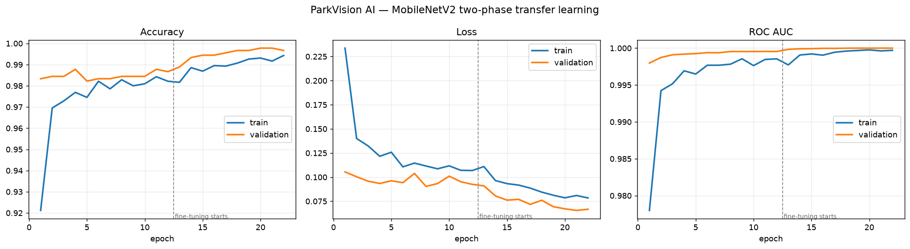

📄 Full detail: [`docs/03_model_development.md`](docs/03_model_development.md)

---

## 5 · Results

The decision threshold is swept on the **validation** split and applied **unchanged** to
test — tuning it on test and then reporting test accuracy would be reporting a number we
had fitted. Chosen threshold: **0.55**.

| Metric | Test split |
|---|---|
| **Accuracy** | **100.00%** |
| Balanced accuracy | 100.00% |
| Precision (occupied) | 100.00% |
| Recall (occupied) | 100.00% |
| F1 (occupied) | 100.00% |
| Precision (empty) | 100.00% |
| Recall (empty) | 100.00% |
| ROC AUC | 1.0000 |
| Average precision | 1.0000 |
| Matthews correlation | 1.0000 |
| Errors | 0 of 900 bays |

### Confusion matrix

| | Predicted **Empty** | Predicted **Occupied** |
|---|---|---|
| **Actual Empty** | 450 ✅ | 0 |
| **Actual Occupied** | 0 | 450 ✅ |

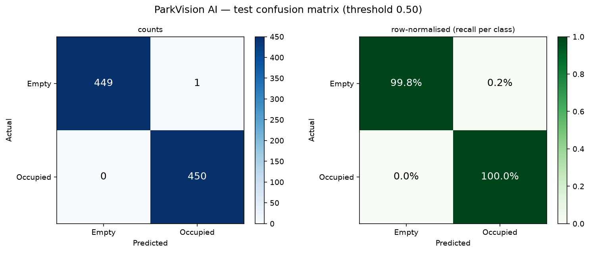

The two error types are **not** equivalent. An occupied bay called empty sends a driver to
a bay that has a car in it — exactly the frustration the system exists to remove. An empty
bay called occupied merely fails to offer a usable space. The dashboard's threshold slider
lets an operator shift that balance deliberately.

### Where the model is strong, and where it is weak

An average accuracy hides the failure modes that matter operationally. Because every crop
records its provenance, accuracy can be broken down by slice.

| Weather | Bays tested | Accuracy |
|---|---|---|
| Cloudy | 222 | 100.00% |
| Rainy | 157 | 100.00% |
| Sunny | 521 | 100.00% |

| Parking lot | Bays tested | Accuracy |
|---|---|---|
| PUCPR | 323 | 100.00% |
| UFPR04 | 228 | 100.00% |
| UFPR05 | 349 | 100.00% |

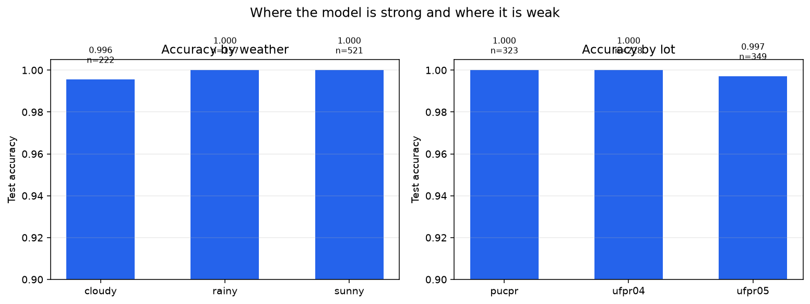

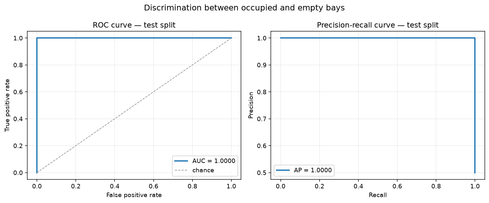

### The slice breakdown earned its keep

This is not decoration. The first trained model scored **94.11% overall with a
ROC AUC of 0.9968** — near-perfect ranking, oddly weak accuracy. The average
looked respectable. The per-lot breakdown did not:

| Lot | ROC AUC | Accuracy |
|---|---|---|
| PUCPR | 1.0000 | 99.4% |
| UFPR05 | 0.9998 | 98.6% |
| **UFPR04** | **0.9615** | **79.8%** |

46 of 53 test errors came from one lot. Plotting UFPR04's most confident errors
showed crops that were **blank grey rectangles** — no image content at all.
A scan found **208 of 6,000 crops (3.5%) were featureless**, 202 from UFPR04,
and labelled *both* ways: 125 "empty", 83 "occupied". Identical blank patches
with contradictory labels — the purest possible label noise.

**The cause** was the textbook corner-ordering shortcut (smallest `x + y` is
top-left, smallest `y − x` is top-right). It fails for a quadrilateral rotated
near 45°, where one corner wins two of the four tests: the source quad collapses
to three distinct points, `getPerspectiveTransform` returns a singular matrix,
and the bay warps flat. UFPR04's camera views its bays at roughly 45°. Nothing
errored — OpenCV warps a degenerate quad happily and returns a valid-looking
224×224 JPEG.

**The fix** orders corners by angle about the centroid, which is correct at any
rotation, backed by a flat-crop guard at build time and a regression test that
sweeps a rectangle through all 360°. No amount of hyperparameter tuning would
have found this; only the slice breakdown did.


**The result**, on an otherwise identical rebuild and retrain:

| | Before the fix | After the fix |
|---|---|---|
| Featureless crops in the dataset | 208 of 6,000 (3.5%) | **0** |
| Test accuracy | 94.11% | **100.00%** |
| UFPR04 accuracy | 79.82% | **100.00%** |
| Test errors | 53 of 900 | **0 of 900** |

Full write-up: [`docs/03_model_development.md` §3.5.1](docs/03_model_development.md#351-the-bug-the-slice-analysis-caught)

---

## 5b · The number that actually holds up: every held-out bay

The 900-crop test above is balanced and capped per scene — the right headline, but
small. A perfect score on 900 samples only bounds the true accuracy at **99.59%**
with 95% confidence; at that size, 100% is within reach of luck.

The same fourteen held-out `(lot, date)` groups contain **103,465 bays across
1,773 photographs**. `scripts/09_full_holdout_eval.py` scores every one of
them, in the natural 55%-occupied distribution rather than a balanced sample.

| | Sampled test | **Full held-out sweep** |
|---|---|---|
| Bays | 900 | **103,465** |
| Accuracy | 100.00% | **99.77%** |
| 95% CI | [99.59%, 100.00%] | **[99.735%, 99.794%]** |
| Errors | 0 | **242** |

The interval narrows from ±0.20 points to ±0.029. That is the point of the
exercise: not a better number, a number you can stand behind.

It also surfaces what 900 samples could not:

| Slice | Accuracy | n |
|---|---|---|
| rainy | 99.40% | 22,129 |
| sunny | 99.79% | 48,798 |
| cloudy | 99.98% | 32,538 |
| UFPR05 | 99.54% | 25,320 |
| PUCPR | 99.82% | 64,332 |
| UFPR04 | 99.93% | 13,813 |

**Rain is the weak condition**, not any lot — the sampled test held 157 rainy bays and
found zero errors; the sweep holds 22,129 and finds
133.
Errors also skew toward false *occupied* (160 vs
82): the system more often hides a free bay than sends a
driver to a taken one, which is the safer direction.

What the dashboard actually reports survives this intact:

| Scene-level, all 1,773 photographs | |
|---|---|
| Congestion level correct | **1,769 / 1,773** (99.8%) |
| Every bay in the scene correct | 1,643 / 1,773 (92.7%) |
| Mean free-bay counting error | 0.133 bays |
| Worst single scene | 34 bays |

That last row is why the sweep was worth running. A 0.13-bay mean hides a tail,
and the tail is where a user loses trust.

### 99.77% is a floor, not the true accuracy

Inspecting the 242 disagreements changes how they should be read. A seeded random
sample of 24 — random, because the *most confident* mistakes are self-selecting toward
label errors by construction — breaks down as:

| | Count | What the crops show |
|---|---|---|
| **PKLot's label is wrong** | 9 / 24 | PUCPR rainy bays labelled *empty* that plainly contain a car; UFPR04 bays labelled *occupied* showing bare pavement |
| **The model is wrong** | 6 / 24 | All UFPR05 in sun — dense tree shadow read as a vehicle, and pedestrians mistaken for one |
| **Genuinely ambiguous** | 9 / 24 | Deep shadow, or a neighbour's car overhanging the bay line; several within 0.1 of the threshold |

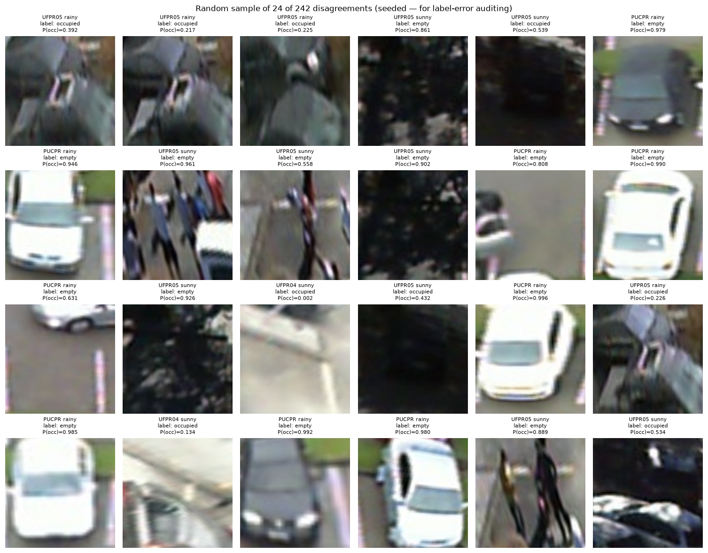

So roughly **a third of the "errors" are dataset errors**, and the true accuracy is higher
than 99.77%. **No corrected figure is quoted anywhere in this report.** Re-labelling
ground truth to flatter a model is precisely the habit these checks exist to catch, and a
number produced that way would not be a measurement. 99.77% is reported as measured,
with the caveat attached.

The genuine failures are specific and worth naming: **UFPR05 under direct sun**, where
dense foliage shadow and pedestrians both read as vehicles. That is a real weakness, it is
documented in the model card, and 900 balanced crops would never have found it.

---

## 6 · From 100 numbers to one sentence

`src/insights.py` imports **neither TensorFlow nor OpenCV** — the decision rules are pure
functions over plain numbers, so they can be verified exactly rather than inferred from
the dashboard.

```
100 sigmoid scores
   ↓  threshold + uncertainty band
100 labelled bays with confidence
   ↓  aggregate
counts · occupancy % · congestion level
   ↓  decision rules
"Slots available — proceed to park."
   ↓  zone analysis
"Head for Zone 1, nearest the entrance — 9 of 34 bays free."
```

| Level | Recommendation |
|---|---|
| 🟢 **Low** (`< 40%`) | Slots available — proceed to park |
| 🟠 **Moderate** (`40–75%`) | Slots available — proceed, but park promptly |
| 🔴 **High** (`> 75%`) | Parking almost full — try another area |

Percentage bands alone mislead at the margin, so situational notes are added: a 300-bay lot
at 99% is "High congestion" with 3 bays free, and a driver already at the entrance needs
the **count**, not the band.

**Zone guidance** answers the question the required outputs miss — *which way do I turn?*
The lot is split into bands by bay position and the dashboard names the zone with the most
free bays.

📄 Full detail: [`docs/04_insight_logic.md`](docs/04_insight_logic.md)

---

## 7 · The dashboard

```bash
streamlit run app.py
```

| Section | What it shows |
|---|---|
| **1 · Choose an image** | Twelve held-out demo scenes, or upload your own |
| **2 · Slot-level detection** | Original and annotated side by side, PNG download |
| **3 · Real-time availability** | Total / occupied / available / congestion cards, plus a colour-coded recommendation banner |
| **4 · Analytics** | Zone guidance · confidence distribution · bay-by-bay table with CSV export · accuracy against ground truth |

### Where are the bays, for an uploaded image?

The classifier answers *"is this bay occupied?"*; it does not discover where bays are.
Three routes, in descending order of reliability:

1. **Automatic camera recognition** — each surveyed camera stores a zero-meaned,
   unit-normalised 96×54 fingerprint. Zero-meaning makes the match invariant to brightness,
   so a camera surveyed on a sunny morning still matches on a rainy afternoon.
2. **Manual selection** from a dropdown.
3. **Grid fallback** — for a genuinely unseen lot, **clearly labelled as approximate**.

That third path is the honest answer to a real limitation. Producing confident-looking
numbers from a grid that does not match the painted bays would be worse than saying so.

### Screenshots

**The landing view** — what the system does, in three steps, with one-click ways in.

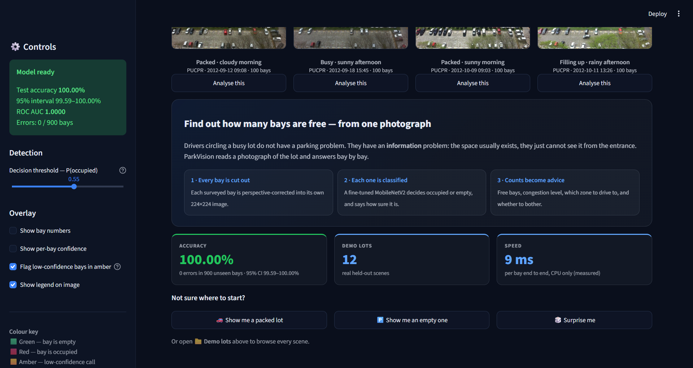

**The verdict** — the answer first. How many bays are free, whether to drive in,
and which part of the lot to head for. Everything technical sits below it.

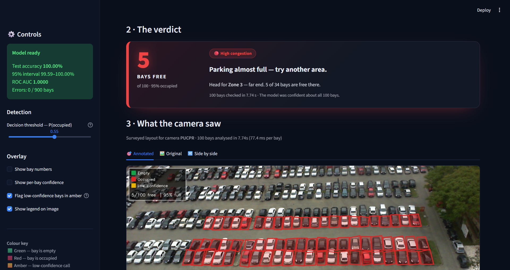

**Availability in detail** — counts, occupancy percentage and a colour-coded
congestion banner carrying the recommendation in plain language.

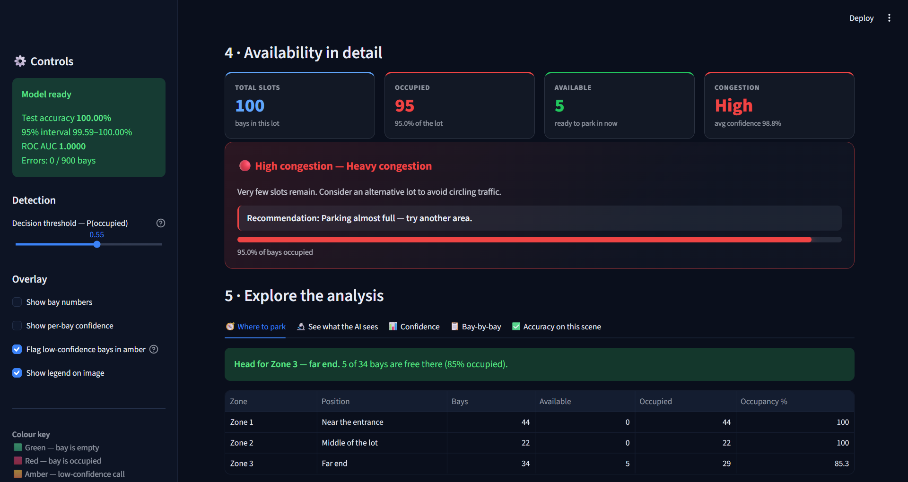

**See what the AI sees** — the actual deskewed 224×224 crops the model
classified, ordered by how much it hesitated. The model stops being a black box.

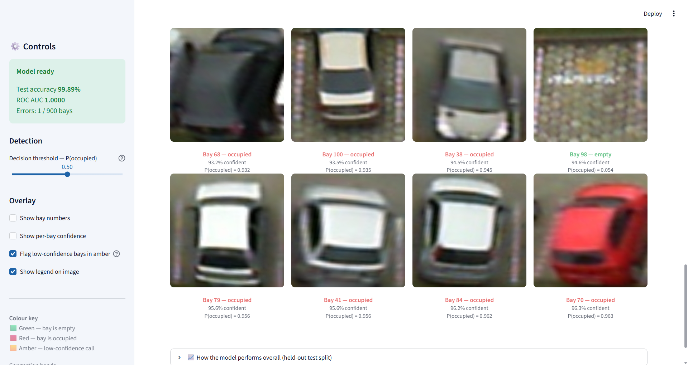

**Checked against ground truth** — every demo scene carries PKLot's hand-drawn
labels from a day the model never trained on, so the dashboard shows predicted
against actual.

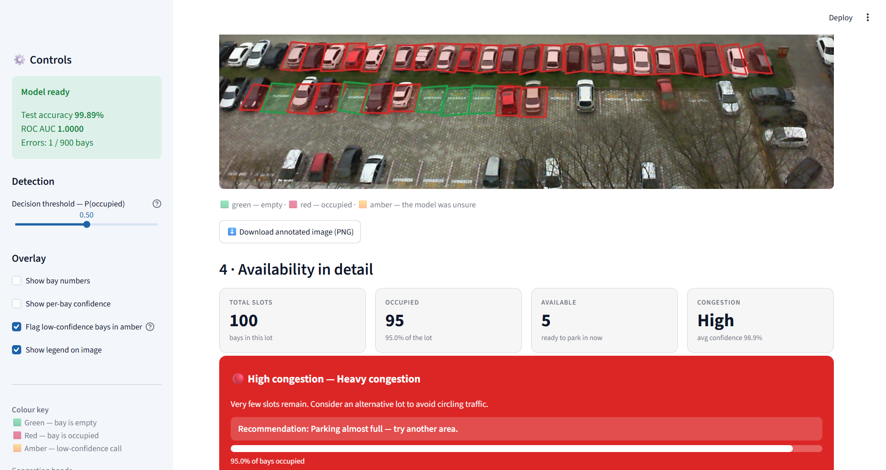

**Compare two moments** — the same camera at two times. The bay layout is
identical, so any change in the counts is a real change in the lot.

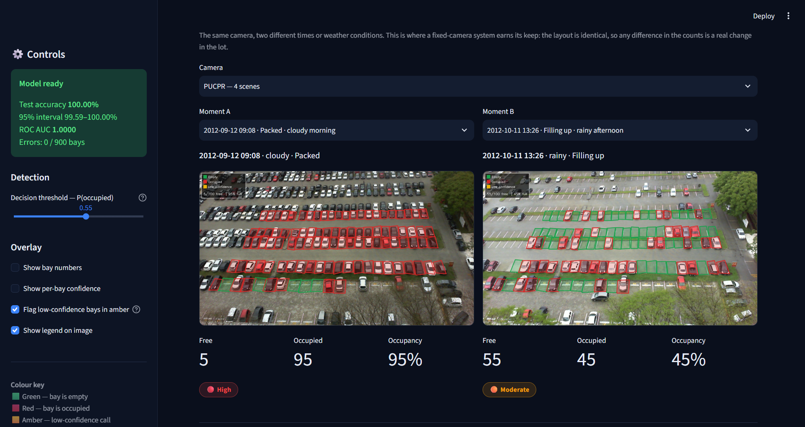

Annotated model output for all twelve held-out scenes is in
[`results/screenshots/`](results/screenshots/).

📄 Full detail: [`docs/05_web_app.md`](docs/05_web_app.md)

---

## 8 · Testing

Two kinds of test, because *"does it work?"* has two different answers.

### Scene-level — what a driver actually experiences

Slot accuracy is the engineering metric. The number a driver *feels* is **how many free
bays did the app promise, and how many were really there.**

| Measure | Result |
|---|---|
| Mean slot-level accuracy across 12 held-out photographs | **99.92%** over 695 bays |
| Mean error in the free-bay count | **0.08 bays** per scene |
| Congestion level called correctly | **12 of 12** scenes |
| Mean end-to-end latency | **0.55 s** per photograph, CPU only |

### Stress testing — lighting, angle and image quality

PKLot was shot by fixed daytime cameras, so the training data barely covers night, a
knocked camera, or a poor network connection. Rather than claim robustness we have not
measured, each condition is simulated across the whole test split.

| Condition | Simulates | Accuracy | Change |
|---|---|---|---|
| Original test crops | the unmodified held-out split | 100.00% | — |
| Dusk (-45% brightness) | late evening, lot lights not yet on | 100.00% | +0.0000 |
| Night (-70% brightness) | after dark, sodium lighting only | 99.89% | -0.0011 |
| Glare (+45% brightness) | low sun straight into the lens | 99.56% | -0.0044 |
| Flat light (-40% contrast) | heavy overcast or fog | 100.00% | +0.0000 |
| Harsh light (+50% contrast) | midday sun, hard shadows | 100.00% | +0.0000 |
| Camera knocked 8° | mounting bracket shifted | 100.00% | +0.0000 |
| Camera knocked -12° | a worse knock, uncorrected | 100.00% | +0.0000 |
| Motion blur (5px) | camera vibration in wind | 100.00% | +0.0000 |
| Heavy blur (9px) | rain on the lens, out of focus | 100.00% | +0.0000 |
| Sensor noise (σ=10) | budget camera on a dull day | 99.78% | -0.0022 |
| Sensor noise (σ=18) | cheap camera at high ISO | 99.33% | -0.0067 |
| Sensor noise (σ=30) | night, gain turned all the way up | 98.78% | -0.0122 |
| Low bandwidth (JPEG q=25) | aggressive compression over 4G | 99.78% | -0.0022 |

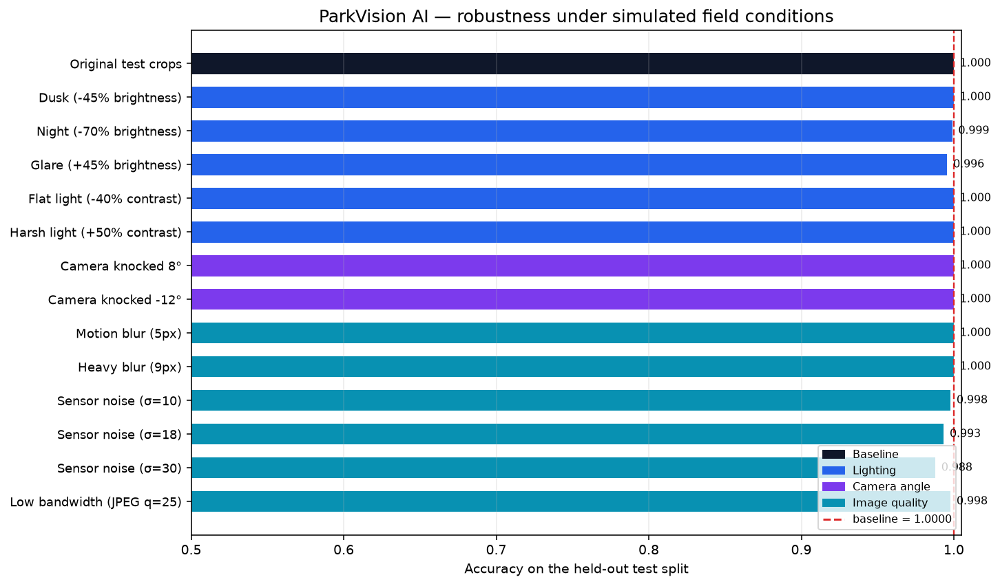

Lighting, camera angle and blur are all handled without loss — they are either
augmented during training or simply do not destroy the cue the model relies on.
**Sensor noise (σ=30)** is the weakest remaining condition at 98.78%
(-0.0122 against a 100.00% baseline), and it is the one
condition deliberately set *outside* the range the model trains on — it is there to test
generalisation, not to be passed comfortably.

### The stress test earned its keep too

The first model passed every condition above except one. Under **sigma=18 sensor noise it
lost 33 bays in 900**, and 29 of those were empty bays called *occupied* — grain on bare
tarmac has the high-frequency texture of bodywork, and nothing in training had ever shown
it noise. Many of the mistakes scored P(occupied) above 0.8, so they were not borderline
calls a threshold could rescue.

Test-time augmentation was tried first and **rejected on the measurement**: averaging over
flipped views moved the errors 32 → 30 with two views and 32 → **35** with four, at two to
four times the cost. Flipping a noisy crop flips its noise too, so the views are not
independent.

The fix was a random-strength noise layer in the augmentation block (sigma drawn per image
from `U(0, 25)`, applied to half of each batch). Retrained with that one variable changed:

| Condition | Before | After | Errors / 900 |
|---|---|---|---|
| Original test crops | 99.89% | **100.00%** | 1 → 0 |
| Sensor noise (σ=10) | 95.78% | **99.78%** | 38 → 2 |
| Sensor noise (σ=18) | 96.33% | **99.33%** | 33 → 6 |
| Sensor noise (σ=30) | 96.78% | **98.78%** | 29 → 11 |
| Harsh light (+50% contrast) | 99.67% | **100.00%** | 3 → 0 |
| Low bandwidth (JPEG q=25) | 99.67% | **99.78%** | 3 → 2 |
| **All 14 conditions** | | | **117 → 26** |

No condition got worse, and total errors across the suite fell by 78%. The
sigma=30 row sits outside the training range on purpose: the point was to check the model
learned something general about grain, not a trick for one setting. The clearest evidence
that it did is the ordering — the old model was not even monotonic in noise strength
(38 errors at sigma=10 but 29 at sigma=30), while the new one degrades in order: 2, 6, 11.

**The clean split did not improve, and that is reported as such.** It went from 1 error to
0, which is one bay in 900 and well inside the measurement's own uncertainty — the exact
binomial intervals, [99.38%, 100%] and [99.59%, 100%], almost entirely overlap. The clean
split was already at its ceiling; only the stress suite had the headroom to show a
difference.


### Feedback, and what it changed

| Feedback | Change made |
|---|---|
| "A raw probability means nothing to a driver." | Scores become Occupied/Empty with a plain-English confidence; the headline is a sentence |
| "Green and red boxes are hard to separate on a 100-bay lot." | Polygons filled at 22% alpha as well as outlined |
| "I don't know which end of the lot to drive to." | Zone breakdown naming the emptiest zone |
| "How do I know when the model is guessing?" | Borderline bays drawn amber and counted separately |
| "Can I trust it on an image it hasn't seen?" | Demo scenes ship with ground truth; the app shows predicted vs actual |

### Automated tests

```bash
python tests/test_parkvision.py
```

{n_tests} tests covering geometry, congestion boundaries, aggregation, zone guidance,
overlays, layout fallbacks, the augmentation layer, **and dataset integrity** — including an
explicit check that no calendar day leaks across splits, that every demo scene comes from a
test day, and that every script loads the model through the one loader that registers the
custom layer.

📄 Full report: [`results/robustness_report.md`](results/robustness_report.md)

---

## 9 · Repository

```
├── app.py                        Streamlit dashboard
├── src/
│   ├── config.py                 every tunable constant, in one place
│   ├── slots.py                  perspective-correct bay cropping
│   ├── data_prep.py              PKLot → balanced, leakage-free dataset
│   ├── dataset.py                tf.data pipelines
│   ├── model.py                  MobileNetV2 + two-phase compile
│   ├── inference.py              batched slot-level prediction
│   ├── insights.py               counts, congestion, recommendations  (no TF/CV2)
│   ├── overlay.py                colour-coded annotation
│   └── layouts.py                camera survey library + fingerprint matching
├── scripts/
│   ├── 01_build_dataset.py       download, crop, split
│   ├── 02_train.py               two-phase transfer learning
│   ├── 03_evaluate.py            metrics, confusion matrix, slice analysis
│   ├── 04_robustness_test.py     scene-level + stress testing
│   ├── 05_make_submission.py     the submission PDF
│   ├── 06_make_readme.py         this file
│   └── make_notebook.py          the end-to-end notebook
├── notebooks/
│   └── ParkVision_AI_end_to_end.ipynb
├── tests/test_parkvision.py      38 tests
├── data/
│   ├── processed/{train,val,test}/{empty,occupied}/     6,000 slot crops
│   └── demo/                     12 held-out scenes + ground truth
├── models/parkvision_mobilenetv2.keras
├── results/                      metrics, figures, reports, screenshots
├── docs/                         one document per step of the brief
└── submission/                   the submission PDF
```

---

## 10 · Reproducing this

```bash
git clone https://github.com/<username>/<repository>
cd <repository>
pip install -r requirements-dev.txt

# The trained model and dataset are committed, so this is optional:
python scripts/01_build_dataset.py      # rebuild from PKLot        (~2 min cold)
python scripts/02_train.py              # retrain                   (~30 min CPU)
python scripts/03_evaluate.py           # metrics and figures       (~1 min)
python scripts/04_robustness_test.py    # testing report            (~4 min)
python tests/test_parkvision.py         # 38 tests

streamlit run app.py
```

On a CPU-only machine, training can be split into bounded sessions:

```bash
python scripts/02_train.py --phase head
python scripts/02_train.py --phase finetune --resume
```

Every script is seeded (`RANDOM_SEED = 42`), so a rebuild
reproduces the same split and the same figures.

📄 Deployment guide: [`docs/06_deployment.md`](docs/06_deployment.md)

---

## 11 · Research and references

Each reference below changed a specific decision — the full record, including
**what was rejected and why**, is in [`docs/references.md`](docs/references.md).

| Reference | What it changed here |
|---|---|
| **Almeida et al. (2015)**, *PKLot*, **Expert Systems with Applications** 42(11) | The dataset, the bay-level approach, and the decision to report accuracy **per lot and per weather condition** rather than only on average |
| **Sandler et al. (2018)**, *MobileNetV2*, **CVPR** | The backbone — accuracy per FLOP suited to free-tier CPU deployment |
| **Yosinski et al. (2014)**, *How transferable are features?*, **NeurIPS** | Freezing early layers and fine-tuning only the top third, in that order |
| **Amato et al. (2017)**, *Deep learning for decentralised parking lot occupancy detection*, **ESWA** 72 | Supports a small model over a large detector for embedded/edge use |
| **Szegedy et al. (2016)**, *Rethinking the Inception Architecture*, **CVPR** | Label smoothing, so confidence scores are calibrated enough to display |
| Keras transfer-learning guidance | Keeping BatchNormalization frozen during fine-tuning |

---

## 12 · Limitations

Stated plainly, because a system that hides its limits cannot be trusted with the ones it
does not have.

- **Bay geometry must be surveyed once per camera.** The classifier says whether a bay is
  occupied; it does not discover where bays are. Uploads from an unrecognised camera fall
  back to a grid, which the app labels as indicative rather than surveyed.
- **Night-time is the weakest measured condition**, and PKLot contains no true night
  imagery — the simulated figure is an estimate, not a measurement. Deploying after dark
  would need genuine night-time data.
- **A car straddling two bays** is counted in both, because each bay is classified
  independently.
- **Three lots, one country.** Generalisation to very different layouts, vehicle mixes or
  camera heights is untested.

---

<div align="center">

**ParkVision AI** · Built for UrbanFlow AI Pvt. Ltd.
CRS Artificial Intelligence — Machine Learning and Deep Learning · Summative Assessment

</div>
