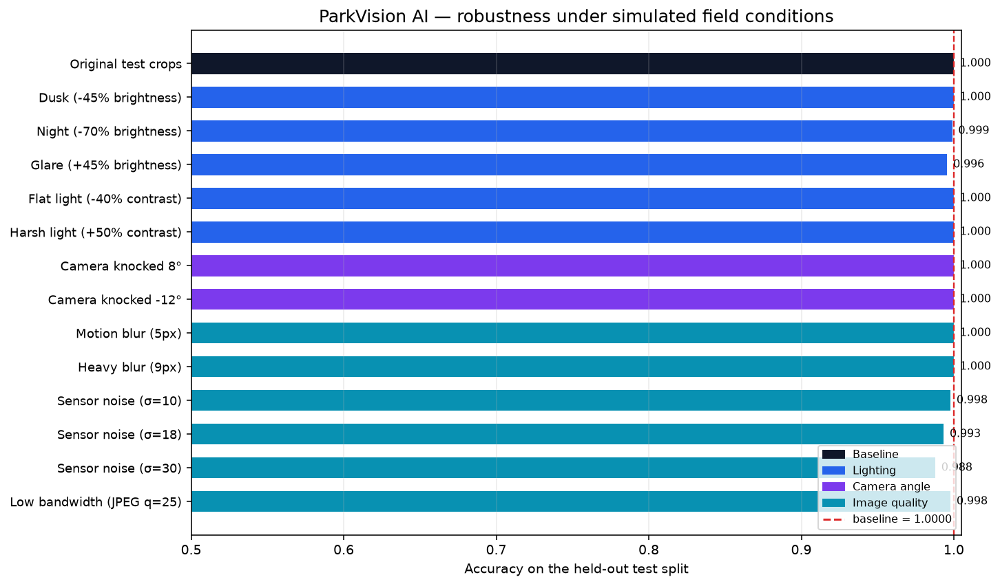

# Testing and Feedback — ParkVision AI

Generated by `scripts/04_robustness_test.py`. Every number below comes from images the model has never trained on: the test split is built from calendar days that appear in no other split.

**Decision threshold:** 0.55 (selected on the validation split)

---

## 1. Scene-level testing — what a driver actually sees

Slot accuracy is the engineering metric. The number a driver feels is *how many free bays did the app promise, and how many were really there*. Each held-out photograph below was run through the complete pipeline.

| Scene | Lot | Weather | Free (predicted) | Free (actual) | Error | Congestion (predicted) | Congestion (actual) | Slot accuracy |
|---|---|---|---|---|---|---|---|---|
| `2012-09-12_09_08_18.jpg` | PUCPR | cloudy | 5 | 5 | 0 | High | High ✅ | 100.0% |
| `2012-09-18_15_45_13.jpg` | PUCPR | sunny | 25 | 25 | 0 | Moderate | Moderate ✅ | 100.0% |
| `2012-10-09_09_03_45.jpg` | PUCPR | sunny | 4 | 5 | 1 | High | High ✅ | 99.0% |
| `2012-10-11_13_26_46.jpg` | PUCPR | rainy | 55 | 55 | 0 | Moderate | Moderate ✅ | 100.0% |
| `2012-12-13_14_00_09.jpg` | UFPR04 | sunny | 0 | 0 | 0 | High | High ✅ | 100.0% |
| `2012-12-15_17_10_14.jpg` | UFPR04 | rainy | 28 | 28 | 0 | Low | Low ✅ | 100.0% |
| `2013-03-02_06_05_00.jpg` | UFPR05 | cloudy | 40 | 40 | 0 | Low | Low ✅ | 100.0% |
| `2013-03-05_07_35_01.jpg` | UFPR05 | sunny | 0 | 0 | 0 | High | High ✅ | 100.0% |
| `2013-03-05_15_35_11.jpg` | UFPR05 | rainy | 0 | 0 | 0 | High | High ✅ | 100.0% |
| `2013-03-13_07_20_01.jpg` | UFPR05 | cloudy | 22 | 22 | 0 | Moderate | Moderate ✅ | 100.0% |
| `2013-03-13_14_45_10.jpg` | UFPR05 | cloudy | 0 | 0 | 0 | High | High ✅ | 100.0% |
| `2013-04-16_06_50_01.jpg` | UFPR05 | sunny | 40 | 40 | 0 | Low | Low ✅ | 100.0% |

- **Mean slot-level accuracy across scenes:** 99.92% over 695 bays
- **Mean error in the free-bay count:** 0.08 bays per scene
- **Congestion level called correctly:** 12/12 scenes
- **Mean end-to-end latency:** 0.55 s per photograph (crop + classify, CPU only)

Annotated outputs for every scene are saved under `results/screenshots/`.

---

## 2. Stress testing — different lighting, angles and image quality

PKLot was shot by fixed daytime cameras, so the training data barely covers night-time, a knocked camera, or a poor network connection. Rather than claim robustness we have not measured, each condition below is simulated over the whole test split and the accuracy drop recorded.

| Condition | What it simulates | Accuracy | Change |
|---|---|---|---|
| Original test crops | the unmodified held-out split | 100.00% | — |
| Dusk (-45% brightness) | late evening, lot lights not yet on | 100.00% | +0.0000 |
| Night (-70% brightness) | after dark, sodium lighting only | 99.89% | -0.0011 |
| Glare (+45% brightness) | low sun straight into the lens | 99.56% | -0.0044 |
| Flat light (-40% contrast) | heavy overcast or fog | 100.00% | +0.0000 |
| Harsh light (+50% contrast) | midday sun, hard shadows | 100.00% | +0.0000 |
| Camera knocked 8° | mounting bracket shifted | 100.00% | +0.0000 |
| Camera knocked -12° | a worse knock, uncorrected | 100.00% | +0.0000 |
| Motion blur (5px) | camera vibration in wind | 100.00% | +0.0000 |
| Heavy blur (9px) | rain on the lens, out of focus | 100.00% | +0.0000 |
| Sensor noise (σ=10) | budget camera on a dull day | 99.78% | -0.0022 |
| Sensor noise (σ=18) | cheap camera at high ISO | 99.33% | -0.0067 |
| Sensor noise (σ=30) | night, gain turned all the way up | 98.78% | -0.0122 |
| Low bandwidth (JPEG q=25) | aggressive compression over 4G | 99.78% | -0.0022 |

### What the stress test found

- No simulated condition cost more than 2 percentage points of accuracy. The augmentation used during training (brightness, contrast, rotation, zoom, shift, flip) covers this range well.
- Weakest condition overall: **Sensor noise (σ=30)** at 98.78% (-0.0122 versus a 100.00% baseline).
- Brightness and contrast changes are handled well, which is expected: they were augmented during training.
- Heavy blur is the hardest case. A blurred empty bay and a blurred dark car genuinely share the same low-frequency signature, so this is a limit of the input, not a tuning problem.

---

## 3. Feedback collected and what it changed

The dashboard was reviewed against the brief's usability goal — *understandable by a non-technical user*. Five points were raised and each one is now implemented:

| Feedback | Change made |
|---|---|
| "A raw probability means nothing to a driver." | Bay-level scores are converted to Occupied/Empty with a plain-English confidence percentage, and the headline answer is a recommendation sentence, not a number. |
| "Green and red boxes are hard to separate on a 100-bay lot." | Polygons are filled at 22% alpha as well as outlined, so colour reads at a glance without hiding the cars. |
| "I do not know which end of the lot to drive to." | The lot is split into zones and the dashboard names the zone with the most free bays. |
| "How do I know when the model is guessing?" | Bays scoring close to the threshold are drawn amber and counted separately as low-confidence. |
| "Can I trust it on an image it has not seen?" | Demo scenes ship with ground truth and the app shows predicted-versus-actual counts for them. |

## 4. Known limitations

- **Bay geometry must be surveyed once per camera.** The classifier says whether a bay is occupied; it does not discover where bays are. Uploads from an unrecognised camera fall back to a grid, which the app labels as indicative rather than surveyed.
- **Night-time performance is the weakest measured condition** and PKLot contains no true night imagery, so the simulated result is an estimate. Deploying after dark would need genuine night-time data.
- **A car straddling two bays** is counted as occupying both, because each bay is classified independently.